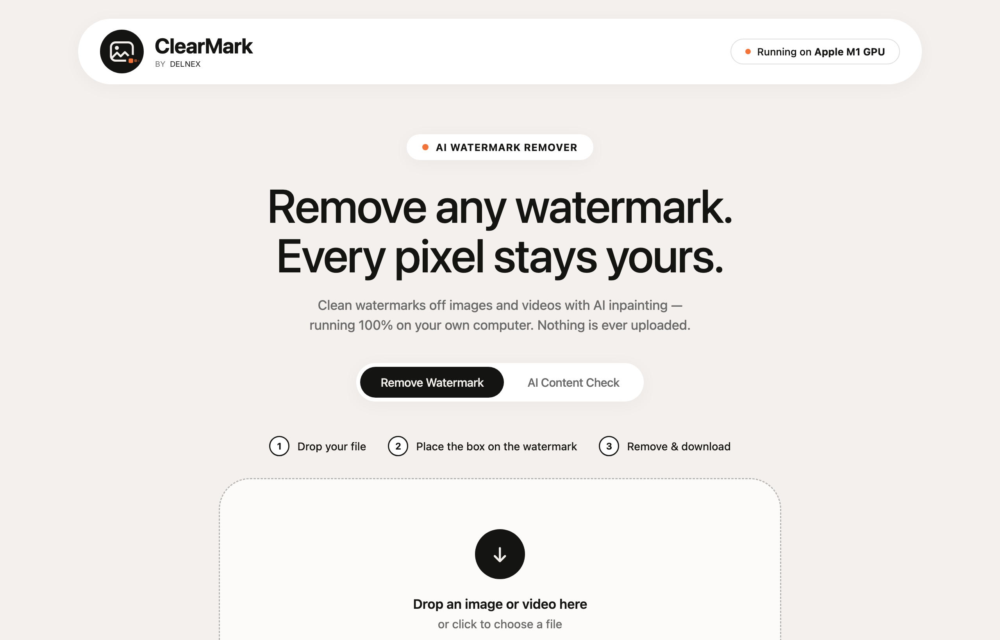

# ClearMark

**AI Watermark Remover for images and videos — runs entirely on your own computer.**

*Designed & Developed by DelNex*



Two tools in one small app:

1. **Remove Watermark** — erase watermarks (Gemini, Veo, Sora, Meta AI, stock logos …)
   from images and videos. An AI model rebuilds what was behind the watermark, so you
   get real texture and detail instead of a blurred patch.
2. **AI Content Check** — inspect a file's own metadata to see whether it declares
   being AI-generated, camera-shot, or neither.

Nothing is ever uploaded. There is no account or fee. Internet is used for first-run
setup and automatic update checks when the app starts.

---

## Getting started

### Step 0 — Get the files

**The easy way (recommended).** If you have `git`, clone it:

```bash
git clone https://github.com/DelNex/CleanMark.git
```

Clone or extract the project, then use the platform launcher below.

**Or download the ZIP** from the green **Code** button above. That route *is* flagged by
your operating system, so Windows may show a SmartScreen prompt on first launch.

### Step 1 — Start ClearMark

- **Windows:** double-click **`Start ClearMark (Windows).bat`**.
- **Linux:** run `./start.sh`. The explicit `./start-linux.sh` entry point is kept for
  compatibility.

The launcher prepares the Python environment. If Python 3.10 or newer is missing,
it downloads a private Python 3.12 runtime into the ClearMark folder using the
[uv installer](https://docs.astral.sh/uv/getting-started/installation/). This does not
install Python system-wide or change your PATH. Linux may still need GTK and WebKitGTK
system packages for the native window.

The launchers install required packages and fetch the LaMa model on first run.
ClearMark opens in its own desktop window.

At each launch, ClearMark checks the GitHub `main` branch and automatically applies
newer changes before starting. Git checkouts are updated only when their working tree
is clean; packaged installs update their application files while preserving the local
Python environment and optional tools. If GitHub is unavailable, the installed copy
starts as usual and the updater retries on the next launch.

Closing the desktop window stops ClearMark.

After setup, ClearMark registers itself in the current user's application search:
search **ClearMark** in the Linux app launcher or Windows Start menu. The menu
shortcut opens the native window directly without a terminal. Keep the extracted
ClearMark folder in the same location after setup; the shortcut points to that folder.

---

### Windows: first run (one time, several minutes)

Windows tags downloaded files with the **Mark of the Web**, and SmartScreen may show
*"Windows protected your PC — Microsoft Defender SmartScreen prevented an
unrecognised app from starting."*

**This is not a virus warning either.** It means the app has no paid Microsoft
code-signing certificate, which is true of most small and open-source tools.

Clear it **before extracting** — that way every file comes out clean in one go:

1. Right-click the downloaded ClearMark ZIP archive
2. Choose **Properties**
3. At the bottom of the General tab, tick **Unblock**
4. Click **OK**
5. Now extract the zip (right-click → **Extract All**) and double-click
   **`Start ClearMark (Windows).bat`**

If the **Unblock** tick-box isn't there, the file was never flagged — just extract and
run it.

**Already extracted without unblocking?** Double-click the `.bat`, and when the blue
SmartScreen box appears click **More info**, then **Run anyway**. You'll need to do this
each time until you unblock the file itself via Properties → **Unblock**.

---

## Using it

### Removing a watermark

1. Drop an image or video onto the page (or click to browse).
2. For a video, use the built-in controls to play or scrub through frames. An orange
   box appears in the bottom-right corner, where most AI watermarks sit.
   Drag it over the watermark; the dot in its corner resizes it.
   **Keep the box snug** — the AI rebuilds everything inside it, so a tight box gives
   the most accurate result.
3. Click **Remove watermark**. Videos show a progress bar with a live time estimate,
   and an **Abort** button if you change your mind.
4. Download the cleaned file.

### Checking whether something is AI-generated

Switch to the **AI Content Check** tab and drop in any file. ClearMark reads the
provenance data the file carries — Content Credentials (C2PA), the IPTC synthetic-media
tag, generator names in EXIF/XMP, and the generation blocks that tools like ComfyUI and
Automatic1111 embed — then reports a verdict with the evidence behind it.

**Please read the result carefully.** Metadata is strong evidence when it is there, but
screenshots, re-encodes and social-media uploads strip it away. **"Inconclusive" does
not mean "authentic"** — it means the file isn't carrying any evidence either way.
ClearMark also cannot read invisible watermarks such as Google SynthID; for those, use
Google's "About this image" in Search or the Gemini app.

---

## Speed

ClearMark uses your graphics card when it can, and shows which one it's using at the top
of the page.

| Hardware | Roughly |
|---|---|
| Windows PC with an NVIDIA GPU | similar or faster |
| CPU only | ~2–5 sec per video frame |

Images take only a few seconds on any machine. If you're on a CPU-only laptop, start
with a short video clip to get a feel for the timing — the app will tell you when it's
running in CPU mode.

---

## Privacy

Your files never leave your computer. That isn't a promise, it's how it's built:

- The AI model is a file on your disk. It has no API and nothing to call home to —
  removal was verified working with all networking blocked.
- The app listens on `127.0.0.1` only, so nothing else on your network can reach it,
  let alone anything on the internet.
- The web page is fully self-contained — no CDNs, no fonts loaded from Google, no
  analytics. It works with Wi-Fi switched off.
- Files you drop in are held in a temporary folder only while being processed, then
  deleted automatically.

ClearMark uses the internet for initial setup and to check for application updates at
launch. Watermark processing stays on your computer.

---

## Optional extra

Installing **ExifTool** (<https://exiftool.org>) makes the AI Content Check more
thorough, especially for videos. During setup, the launcher asks whether to download it
into the ClearMark folder. Type **Y** to install or press Enter to skip. Linux needs
Perl to run ExifTool; Windows downloads its self-contained executable. ClearMark works
fine without it and reports when it is running in reduced mode.
If you skip it and want it later, run `.venv/bin/python scripts/install_optional.py exiftool`
on Linux or `.venv\Scripts\python.exe scripts/install_optional.py exiftool` on Windows.

---

## If something goes wrong

**Windows: "Windows protected your PC" (blue SmartScreen box)** — expected on a fresh
download; see **"Windows: first run"** above. Click **More info → Run anyway** to
continue now, or unblock the file properly via Properties → **Unblock**.

**Windows: the console window flashes open and closes instantly** — the `.bat` was
extracted on its own, without the rest of the folder. Extract the whole zip and keep all
the files together.

**Python setup fails** — check your internet connection and run the launcher again. If
the private runtime download is blocked, install Python 3.10 or newer manually and retry.

**Setup fails partway** — check your internet connection and run the launcher again.
The environment and downloaded model stay in place so completed setup work can be reused.

**Starting fresh** — delete `.venv` and `.runtime` inside the ClearMark folder, then run
the launcher again to rebuild its private Python environment.

**Window does not open on Linux** — install pywebview's GTK/WebKitGTK system
dependencies, then run `./start-linux.sh` again.

---

## For developers

```
desktop.py      native desktop window and lifecycle
app.py          Flask server factory and API
remover.py      LaMa inpainting engine (images + video)
detector.py     provenance / metadata analysis
scripts/        updater, optional tools, and platform integration helpers
start-windows.ps1     Windows setup and launch flow
static/         self-contained web UI, bundled Sofia Sans font
requirements.txt
```

Command line, once set up:

```bash
.venv/bin/python remover.py photo.png                       # Linux
.venv\Scripts\python remover.py photo.png                   # Windows
.venv/bin/python remover.py clip.mp4 --box 1150,630,110,70  # explicit x,y,w,h
.venv/bin/python detector.py suspect.jpg                    # provenance report as JSON
```

Built with PyTorch (LaMa inpainting), OpenCV, Flask, and a bundled ffmpeg via
`imageio-ffmpeg`.

---

## License

ClearMark's source code is **MIT licensed** — see [LICENSE](LICENSE). Use it, modify it,
learn from it.

**One important restriction, which is not mine to waive:** the LaMa model weights that
ClearMark downloads on first run are licensed **CC BY-NC-SA 4.0** by their authors —
**non-commercial use only**. Personal, educational and research use is fine. Selling
ClearMark or its output is not, unless you swap in a differently licensed model.

Full details of every component, including the bundled Sofia Sans font (SIL Open Font
License 1.1) and the intended-use notes, are in
[THIRD-PARTY-NOTICES.md](THIRD-PARTY-NOTICES.md).

**On watermark removal:** inpainting is standard technology — this is the same operation
as Photoshop's Content-Aware Fill. Removing a watermark does not remove the underlying
copyright, and you are responsible for having the right to edit what you process. Please
read the intended-use section before using it on anything that isn't yours.
